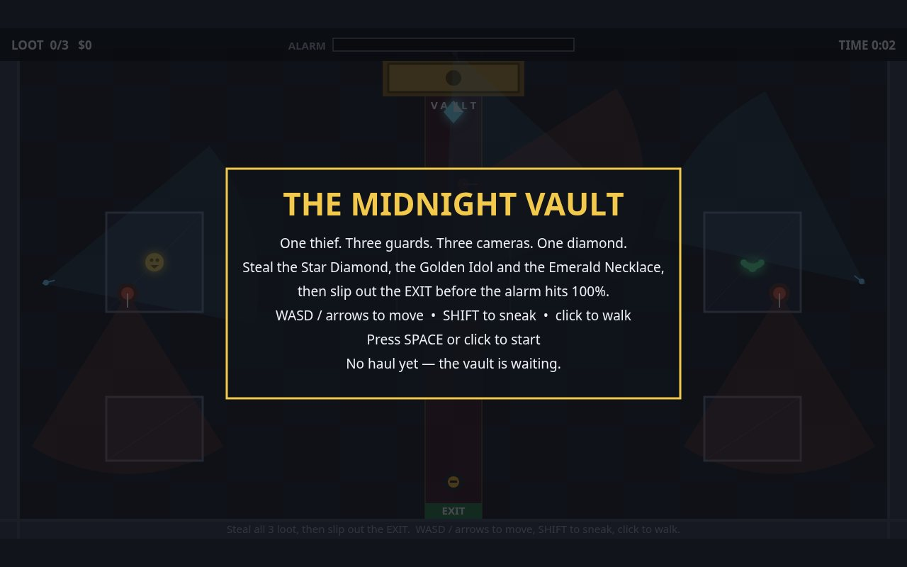

# The Midnight Vault — a heist game


A complete, original top-down stealth heist game that plays offline in a
desktop browser from static files. Built for the make.fun bounty
[best-heist-game-20261122-0559](https://make.fun/bounty/best-heist-game-20261122-0559)
("Make the best heist game").



## The heist

One thief. Three guards. Three cameras. One diamond.

You are the thief crossing a museum gallery after midnight. Steal the
**Star Diamond** from the vault, the **Golden Idol** and the **Emerald
Necklace** from their display cases, then slip out the green EXIT before the
alarm meter hits 100%.

- **Guards** patrol the gallery with visible vision cones. Step into a cone
  and the alarm climbs fast; the guard turns on you and gives chase.
- **Wall cameras** sweep the room on a fixed rhythm — time your crossing
  between sweeps.
- **Sneak** (hold `SHIFT`) to move slower and raise the alarm half as fast.
  Display cases and the statue block both movement and line of sight, so
  use them as cover.
- **Alarm meter** drains while you stay unseen, so breaking line of sight
  is how you survive.
- Grab all three loot pieces ($93,000) and reach the EXIT for a clean
  getaway and a time bonus.

## Controls

| Input | Action |
| --- | --- |
| `WASD` / arrow keys | Move |
| `SHIFT` (hold) | Sneak — slower, half the alarm rise |
| Mouse click | Walk to that spot (click-to-move) |
| `SPACE` / `ENTER` / click | Start, restart |
| `P` / `ESC` | Pause |
| `R` | Restart after being caught or escaping |

Synthesized sound effects (Web Audio, no audio files): pickup chime, spotted
warning, caught sting, getaway fanfare.

## Play it

No build step, no network request — every file the game loads lives under
`game/`.

```sh
node serve.ts
# open http://localhost:8080
```

Or open `game/index.html` through any static file server.

## Screenshots

All four are real renders of the game's own code, taken in desktop Chrome
(`?shot=start|play|vault|end&seed=1`):

| Shot | Scene |
| --- | --- |
| `screenshots/1-start.jpg` | Title screen over the gallery |
| `screenshots/2-play.jpg` | Mid-heist: one loot pocketed, spotted, alarm climbing |
| `screenshots/3-vault.jpg` | The Star Diamond just taken, guard closing in, alarm 71% |
| `screenshots/4-end.jpg` | Caught — the alarm hit 100% |

## Layout

```
main.ts            entry point: copies game/ + screenshots/ to /output,
                   writes /output/dossier.json (see vendor/makefun-game.ts)
serve.ts           tiny static server for local play-testing
vendor/
  makefun-game.ts  make.fun dossier library, copied from the kit unchanged
game/
  index.html       page shell + canvas
  src/
    config.js      tuning, palette, room layout, patrol routes
    random.js      seeded RNG (mulberry32) — repeatable scenes
    input.js       keyboard + click-to-move
    world.js       simulation: movement, guards, cameras, sight, alarm, loot
    render.js      canvas renderer: room, cones, loot, HUD, screens
    shots.js       the four staged screenshot scenes
    sound.js       synthesized Web Audio effects
    main.js        boot + fixed-step loop + screens
screenshots/       4 real gameplay renders (see above)
```

## License

MIT — see [LICENSE](LICENSE).
